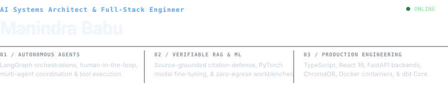
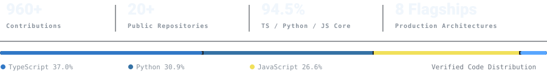

  <!-- Modern Architectural Hero Header -->
  

    

  <!-- 1. Theme-aware Header Banner (dark.svg / light.svg) -->
  <picture>
    <source media="(prefers-color-scheme: dark)" srcset="https://raw.githubusercontent.com/Manindra-babu/Manindra-babu/main/dark.svg">
    <source media="(prefers-color-scheme: light)" srcset="https://raw.githubusercontent.com/Manindra-babu/Manindra-babu/main/light.svg">
    
  </picture>

    

  <!-- Pixel Art Developer Workstation Animation -->
  

    

  <!-- Profile Visitor Counter & Status Badges -->
  

    
    &nbsp;
    
    &nbsp;
    
  

 

### 🔭 Focus & Engineering Philosophy
- 🤖 **Autonomous Multi-Agent Systems:** Designing resilient orchestration graphs with LangGraph, human-in-the-loop review, and self-correcting agent chains.
- 🛡️ **Verifiable RAG & Evaluation:** Grounding LLM outputs with citation defense, source truthfulness validation, and safety benchmarks (FEVER / LIAR).
- ⚡ **Production Systems:** Engineering end-to-end applications from PyTorch transformer cores and FastAPI microservices to high-performance React 19 / Next.js frontends.

 

  <!-- Modern Architectural Telemetry Strip -->
  

    

  <!-- Tech Stack & Core Competencies -->
  <h3>⚡ Tech Stack & Core Competencies</h3>
  

    
    
    
    
    
    
     
    
    
    
    
    
    
     
    
    
    
  

    

  <!-- Featured Projects & Flagship Systems -->
  <h3>🚀 Featured Projects & Systems</h3>
<table border="0" width="100%">
<tr>
<td width="50%" align="left" valign="top">
<h4><a href="https://github.com/Manindra-babu/Kintsu">🛡️ Kintsu (金継ぎ)</a></h4>

Intelligent refund-decision layer for Shopify &amp; WooCommerce stores. Automates return disputes, damage inspection, and policy enforcement with rulebooks and visual condition checks.

<a href="https://kintsu-sj4b.onrender.com/" target="_blank">🌐 Live App</a> &nbsp;|&nbsp; <a href="https://github.com/Manindra-babu/Kintsu" target="_blank">💻 Repository</a>

</td>
<td width="50%" align="left" valign="top">
<h4><a href="https://github.com/Manindra-babu/Rolecraft">🎯 Rolecraft (ResumeIQ)</a></h4>

Evidence-based AI resume intelligence platform with automated claim verification, public GitHub profile analysis, ATS skill-gap roadmaps, and in-place .docx layout preservation.

<a href="https://rolecraft-eta.vercel.app" target="_blank">🌐 Live Demo</a> &nbsp;|&nbsp; <a href="https://github.com/Manindra-babu/Rolecraft" target="_blank">💻 Repository</a>

</td>
</tr>
<tr>
<td width="50%" align="left" valign="top">
<h4><a href="https://github.com/Manindra-babu/ReplyMuse">💬 ReplyMuse</a></h4>

Privacy-first AI review reply studio crafted for cafes, restaurants, clinics, and indie businesses. Crafts personalized, on-brand responses to stinging 1-star reviews in 3 seconds.

<a href="https://replymuse.vercel.app" target="_blank">🌐 Live Application</a> &nbsp;|&nbsp; <a href="https://github.com/Manindra-babu/ReplyMuse" target="_blank">💻 Repository</a>

</td>
<td width="50%" align="left" valign="top">
<h4><a href="https://github.com/Manindra-babu/Research-Agent">🤖 Research-Agent</a></h4>

Autonomous Multi-Agent Research System built with LangGraph, Groq API, DuckDuckGo Search, ChromaDB vector storage, and an interactive intelligence-gathering UI.

<a href="https://github.com/Manindra-babu/Research-Agent" target="_blank">💻 Repository</a>

</td>
</tr>
<tr>
<td width="50%" align="left" valign="top">
<h4><a href="https://github.com/Manindra-babu/Trust-IQ">⚖️ Trust-IQ</a></h4>

Unified AI Trust &amp; Safety Workbench — Classical ML for evidence verification (FEVER), misinformation detection (LIAR), toxicity analysis (Jigsaw), and length-aware fairness.

<a href="https://github.com/Manindra-babu/Trust-IQ" target="_blank">💻 Repository</a>

</td>
<td width="50%" align="left" valign="top">
<h4><a href="https://github.com/Manindra-babu/Knowledge-Base-RAG">🧠 Knowledge-Base-RAG (DocuMind)</a></h4>

Intelligent RAG web application that lets you chat with your private documents (PDF, DOCX, TXT) with precise source citations using Groq LLaMA 3.3 and vector search.

<a href="https://knowledge-base-rag-3lfy.vercel.app/" target="_blank">🌐 Live Demo</a> &nbsp;|&nbsp; <a href="https://github.com/Manindra-babu/Knowledge-Base-RAG" target="_blank">💻 Repository</a>

</td>
</tr>
<tr>
<td width="50%" align="left" valign="top">
<h4><a href="https://github.com/Manindra-babu/MiniGpt">⚡ MiniGpt (GPT-2 From Scratch)</a></h4>

Custom GPT-2 (124M) built from scratch in PyTorch — Multi-Head Attention, Transformer Blocks, SSE token streaming, and an OpenAI-compatible REST API.

<a href="https://huggingface.co/spaces/mani-359/Custom-LLM" target="_blank">🤗 HuggingFace Space</a> &nbsp;|&nbsp; <a href="https://github.com/Manindra-babu/MiniGpt" target="_blank">💻 Repository</a>

</td>
<td width="50%" align="left" valign="top">
<h4><a href="https://github.com/Manindra-babu/Realtime_analytics">📊 Realtime_analytics</a></h4>

Enterprise-grade real-time retail analytics platform featuring a Medallion Architecture warehouse (Bronze/Silver/Gold), dbt Core transformations, and Great Expectations.

<a href="https://github.com/Manindra-babu/Realtime_analytics" target="_blank">💻 Repository</a>

</td>
</tr>
</table>

    

  <!-- Contribution Snake Animation -->
  <picture>
    <source media="(prefers-color-scheme: dark)" srcset="https://raw.githubusercontent.com/Manindra-babu/Manindra-babu/output/github-snake-dark.svg">
    <source media="(prefers-color-scheme: light)" srcset="https://raw.githubusercontent.com/Manindra-babu/Manindra-babu/output/github-snake.svg">
    
  </picture>

    

  <!-- Social Badges Bar (Bottom) -->
  
  &nbsp;&nbsp;
  
  &nbsp;&nbsp;
  

